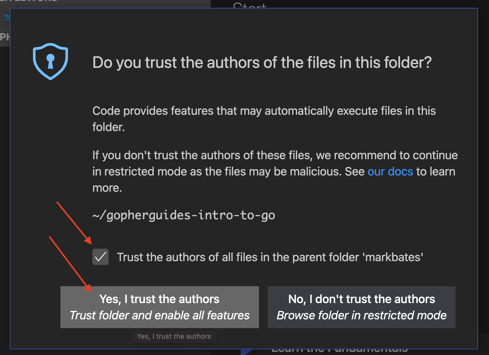

# Assignment/Exercise Setup

## Local Setup

On your computer create a new folder named, `gopherguides-intro-to-go`. Inside of the folder initialize a new git repository with a default branch name of `main`. Initializing a new repository is most easily accomplished using the Terminal program of your OS. Being able to run terminal commands is a required skill of a any developer. We will be using these commands **a lot** in this course.

```bash
$ cd gopherguides-intro-to-go
$ git init -b main
```

> Note: Older Git tutorials and references may reference `master` as the default branch, that is no longer the case. The default branch is now called, `main`. The terms `master` and `slave` are no longer used in the technology community.

Next, open the `gopherguides-intro-to-go` folder in Virtual Studio Code, `File > Open`. You may be presented with a screen asking you whether you trust the folder's authors. Check the checkbox asserting you trust all of the authors. Then click the "Yes, I trust the authors" button to continue. You will only be prompted with this warning once.



Create a new file, `.gitignore`, add the following list of files/folders that Git should ignore, and save and close the file.

```
*.log
.DS_Store
tmp
build/*
.console_history
node_modules/
dist/
generated/
.vendor/
bin/*
.idea/
.vscode
```

Next, we need to add and commit `.gitignore` file to the Git repository. This can be done within Visual Studio Code using a graphical user interface, or GUI. Here we will use the command line instructions for simplicity.

```bash
$ git add --all
$ git commit -m "initial commit"
```

## GitHub Setup