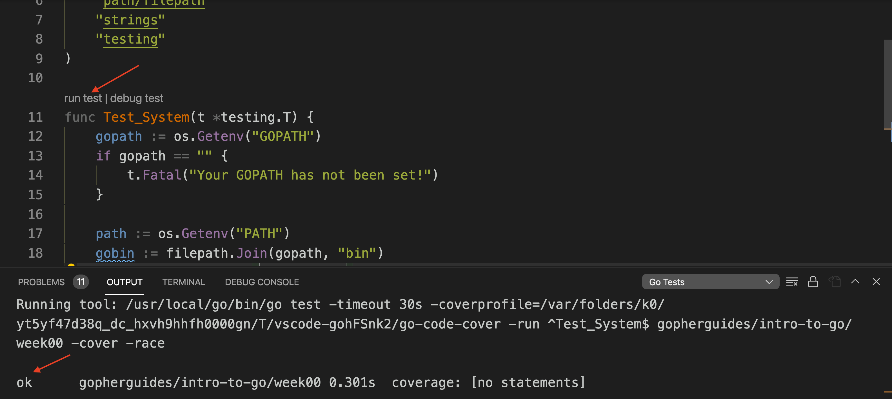

# Exercise (Due Sunday)

### First Time Setup

Locally create a new folder named, `gopherguides-intro-to-go`. Inside of the folder initialize a new git repository.

```bash
$ git init
```

## Exercise Setup

Locally create a new folder named, "gopherguides-intro-to-go". Inside of the folder initialize a new git repository. Next, create a new folder named `gopherguides-intro-to-go/week00`.

Inside of the `week00` folder initialize a new Go module named "github.com/YOUR-USERNAME/gopherguides-intro-to-go/week00".

```
$ go mod init github.com/YOUR-USERNAME/gopherguides-intro-to-go/week00
```

Commit the `go.mod` to the git repository.  Next, on [GitHub.com](https://github.com/) create a new public repository named "gopherguides-intro-to-go" under your account and upload your local repository following the instructions on GitHub.

```text
.
└── gopherguides-intro-to-go
    └── week00
        └── go.mod
```

<code src="./src/assignment01_test.go"></code>

</img>